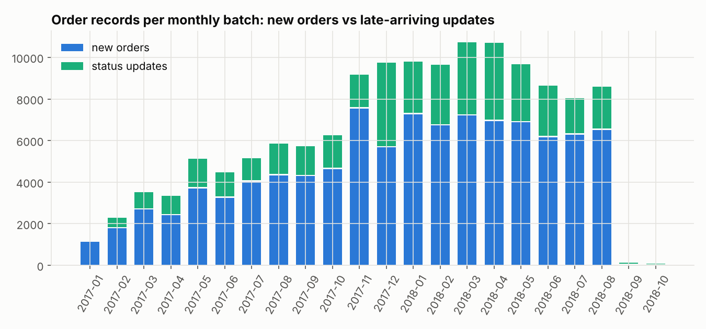
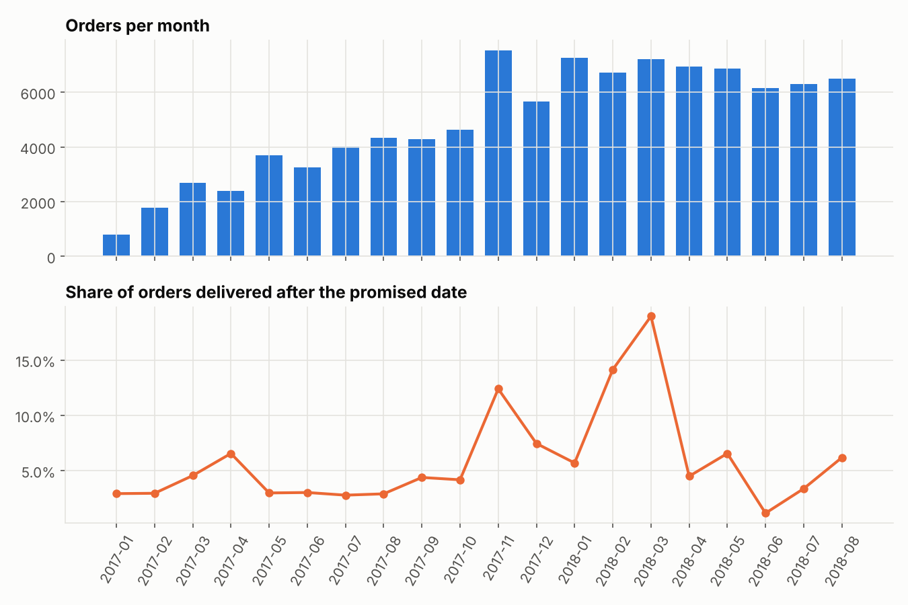
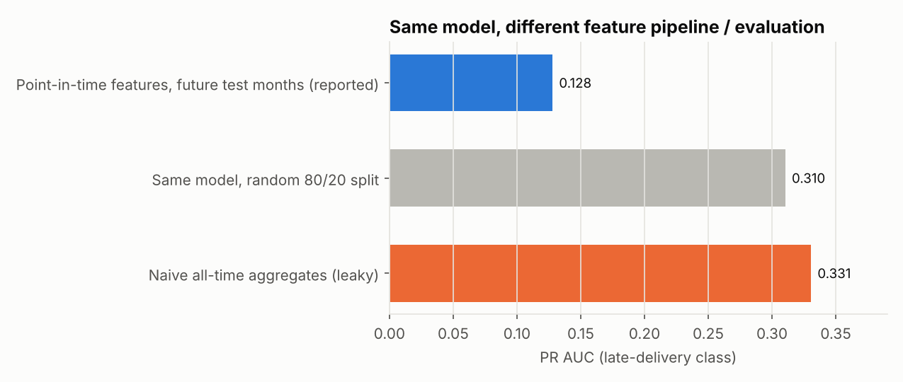
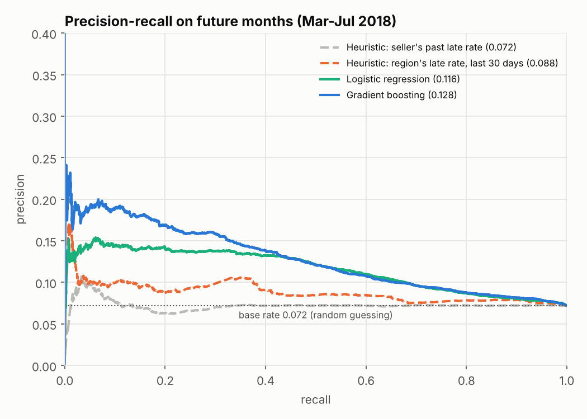
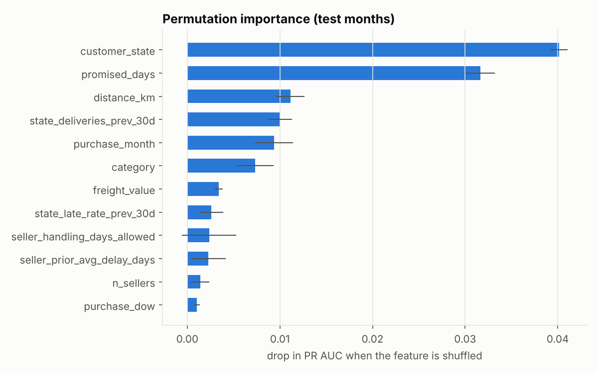
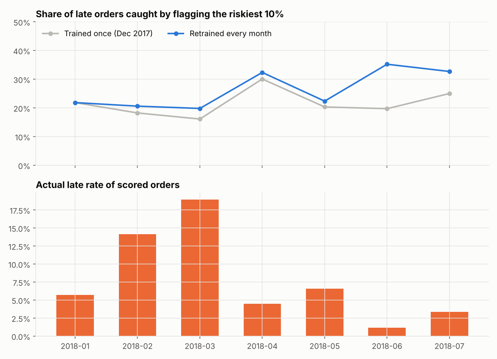
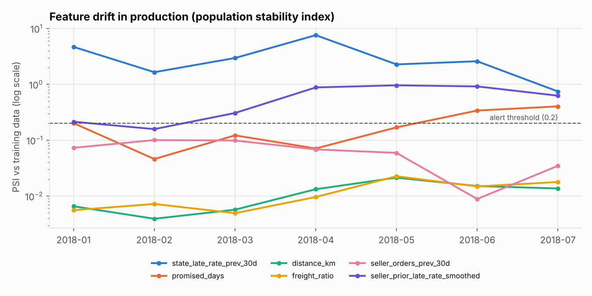

# Olist Data Platform: from Raw E-commerce Dumps to a Monitored ML Model

**A batch data platform (bronze → silver → gold) for 1.5M rows of messy Brazilian e-commerce data, with a late-delivery prediction model trained on point-in-time-correct features, replayed month by month as if it were running in production.**

   

Late deliveries are the single biggest driver of bad reviews on this marketplace: **late orders average 2.26 stars versus 4.28 for on-time orders**. The goal is to flag risky orders the moment they're placed, so operations can act before the customer is let down.

Most portfolio projects start from a clean CSV. This one starts where real work starts: nine raw tables from a source system that sends monthly drops, re-sends orders whenever their status changes, and has duplicates, broken timestamps, encoding errors and points on the wrong continent.

```
 source system           bronze                  silver                     gold                          ml
 (22 monthly drops) ──▶  raw text + lineage ──▶  typed, deduped,       ──▶  star schema + KPI mart  ──▶  point-in-time features
  checksummed            idempotent loads        latest version wins        dim_customer / dim_seller     ↓
                         schema-drift guard      quarantine table           dim_product / dim_date        train ▸ register ▸ score
                                                                            fact_orders / fact_order_items monitor (PSI, monthly metrics)
                         ◀──────────── 36 data-quality tests run after every batch; errors stop the pipeline ────────────▶
```

---

## Headline results

| | |
|---|---|
| Raw input | 9 tables, 1,551,698 rows, replayed as **22 monthly batches** |
| Order records ingested | 136,542 (99,441 new orders + 37,101 late-arriving status updates) |
| Records quarantined or repaired | 772, each with a reason (`silver_quarantine`) |
| Data-quality checks | 36 tests × 22 batches; 0 errors, 2 known source issues tracked as warnings |
| Full rebuild | about 4 minutes on a laptop, from download to reports |
| Model on future months (Mar to Jul 2018) | flagging the riskiest 10% catches **22.5% of late orders, 2.25× better than random** |
| Leakage cost, measured | a naive feature pipeline reports PR AUC **0.331**; the honest number is **0.128** |
| Production replay | monthly retraining beats a frozen model in **6 of 6** months after the first |

---

## 1. Ingestion: making a static dump behave like a real source

`ingest.py` downloads the raw files from a **pinned commit** and verifies **SHA-256 checksums**, so an upstream change can never silently alter results. It then replays the dump as the drops an operational system would actually send:

- Each order appears in the month it was placed, and **again in every later month its status changed** (approved → shipped → delivered), with not-yet-known fields left blank.
- Products, sellers and customers arrive the first time an order references them.
- Every drop has a `_manifest.json` with row counts and checksums.



## 2. Bronze: land it verbatim, safely

`bronze.py` loads each drop into SQLite as raw text and adds lineage columns (`_batch_id`, `_source_file`, `_row_num`, `_loaded_at`).

- **Idempotent.** Reloading a batch replaces exactly that batch, in one transaction, so retries and backfills never duplicate data.
- **Validates before writing.** Checksums must match the manifest, and every file's header must match the expected schema. A renamed or extra column raises `SchemaDriftError` *before* a single row is written.
- **Reconciles.** Rows loaded must equal the manifest count.

## 3. Silver and gold: SQL models with a dependency graph

The transformations are 23 plain SQL files in `sql/`. They reference each other with `{{ ref('model') }}`, and `runner.py` (a small dbt-style runner) does the rest:

- parses those references into a DAG, rejecting unknown references;
- runs the models in topological order;
- builds each table **atomically**: into a temporary table first, then swapped in one transaction, so a failed model never leaves a half-built table;
- records row counts and timings in `meta_model_runs`;
- generates the [lineage graph](docs/lineage.md).

What the silver layer fixes:

| Problem in the raw data | Fix |
|---|---|
| Orders re-sent every time their status changes | Latest version per order wins (`ROW_NUMBER` by batch); version count kept |
| 1,000,163 geolocation rows, 26% exact duplicates, 42 points outside Brazil (Europe, the Atlantic) | De-duplicated, bounding-box filtered, one centroid per zip prefix, plus a city-level fallback |
| Same city spelled `são paulo`, `sao-paulo`, `sa£o paulo` (mojibake) | One `norm_city` UDF used everywhere |
| Zip prefixes like `01037`, quoted inconsistently in the source | Read as text end to end, so leading zeros survive |
| 166 orders handed to the carrier *before* they were purchased | Timestamp nulled, row flagged and quarantined |
| A review ID shared across several orders, and multiple reviews per order | Keyed on (review_id, order_id); latest answer wins per order |
| Two categories with no English translation | `seeds/category_translation_overrides.csv`, dbt-seed style |
| Typo'd source columns (`product_name_lenght`), weight = 0 g | Renamed; impossible values set to NULL |
| `not_defined` payment type, 0 installments | Repaired and flagged |

The gold layer is a star schema: `fact_orders`, `fact_order_items`, `dim_customer` (per real person, not per order), `dim_seller`, `dim_product`, `dim_date`, and a BI-ready `mart_monthly_kpis`.



## 4. Data quality as code

`quality/tests.yaml` declares 36 tests: `unique`, `not_null`, `accepted_values`, `relationships`, `range`, `row_count_min` and custom SQL expressions. They compile to SQL and run after **every** batch, and their results are stored in `meta_dq_results`, so quality can be tracked over time. See the generated [data-quality report](docs/data_quality.md).

- **Error-severity tests stop the pipeline** before the model ever sees bad data.
- **Warnings track known source issues** without stopping the pipeline: 249 orders whose payments don't match their item totals, and 59 customers whose location can't be geocoded.

## 5. ML: point-in-time features

**Task:** when an order is placed, predict whether it will arrive after the date promised to the customer. That is 7% of orders overall, but it swings from 1% to 19% depending on the month.

Every historical feature is computed **only from data that existed before the order's purchase day**, in SQL, from daily aggregates rather than slow per-row subqueries:

- the seller's delivery track record and their order volume over the previous 30 days;
- the late-delivery rate for the customer's region over the previous 30 days, which catches carrier disruptions such as the spike in February to March 2018;
- distance from seller to customer, computed from the address **on that order** (250 customers changed address over time, and a later address must not leak into an older order);
- shipment weight and volume, the promised delivery window, freight, payment details and category.

Labels need the same care. An order's lateness is decided the moment its promised date passes, so a training set at any cutoff uses **label maturity**: it includes undelivered orders that are already past their promise, as late. Training only on delivered orders would bias recent labels toward fast deliveries.

### How much does leakage matter? Measured, not asserted



The same gradient-boosting model scores 2.6× higher if you compute seller and region aggregates over all time (the usual notebook approach), and nearly as high with a random train/test split. **Both numbers are fiction.** The honest number is the blue bar.

### Offline results (train on labels mature by Feb 2018, test on Mar to Jul 2018 purchases)

| Approach | PR AUC | ROC AUC | Top-10% precision | Late orders caught in top 10% |
|---|---|---|---|---|
| Random guessing | 0.072 | 0.500 | 7.2% | 10% |
| Heuristic: seller's past late rate | 0.072 | 0.500 | 7.6% | 10.6% |
| Heuristic: region's late rate, last 30 days | 0.088 | 0.565 | 9.8% | 13.7% |
| Logistic regression | 0.116 | 0.643 | 14.3% | 19.9% |
| **Gradient boosting** | **0.128** | **0.650** | **16.2%** | **22.5%** |



An honest read of these numbers:
- **This is a hard problem.** Most lateness comes from carrier events that happen *after* the order is placed, which no purchase-time model can see. The model is useful for ranking, giving ops a 2.25× better hit rate than random, but it is not an oracle.
- **The model choice is close.** Logistic regression actually edged out gradient boosting on the validation months (PR AUC 0.194 vs 0.155) before losing on the test months. The features and the evaluation design matter far more than the algorithm.
- **What carries the signal:** where the order is going, how long the promised window is, and distance. The seller's own track record barely helps on its own.



## 6. Production replay: train, register, score, monitor

`pipeline run` processes the 22 batches in order, like a scheduled nightly job. From December 2017 onward, each batch:

1. **Scores** the month's new orders with the model that existed *before* the batch, because in production those orders were scored when they were placed;
2. then **retrains** on labels that have matured by the cutoff;
3. and **registers** the model with a version, training row count and data fingerprint (`meta_model_registry`, `models/`).

Two policies run side by side: **trained once** (Dec 2017) and **retrained monthly**.



| Policy (Jan to Jul 2018, 46,427 scored orders with known outcomes) | Mean monthly PR AUC | Late orders caught (top 10% per month) |
|---|---|---|
| Trained once | 0.129 | 21.6% |
| **Retrained monthly** | **0.153** | **26.4%** |

Retraining wins in all 6 months after January (where both policies use the same model). Pooled over all months, the two are about equal (PR AUC 0.129 vs 0.131), because each month's retrained model is calibrated slightly differently. Per month is the operational view, since ops flags 10% of each month's orders.

**A bug I caught in my own pipeline.** The first version scored each month's orders with a model retrained at the *end* of that same month. That model had already seen how some of those orders turned out. It made retraining look twice as good (PR AUC 0.30) as it really is. The fix is the scoring-before-retraining order above, and it's why the replay matters: offline splits alone would never have exposed it.

### Drift monitoring



The population stability index (PSI) of each feature against the frozen model's training data shows *why* the static model decays. The regional late-rate feature sits far above the 0.2 alert threshold (peaking at 7.6 in April 2018) because delivery conditions changed sharply. The seller history feature drifts too, as sellers build up track records the December model never saw.

## Project structure

```
olist-data-platform/
├── config.yaml                 # pinned source + checksums, batch window, ML + monitoring settings
├── src/olist_platform/
│   ├── ingest.py               # checksum-verified fetch; monthly batch simulator
│   ├── bronze.py               # idempotent loads, schema-drift guard, manifest reconciliation
│   ├── warehouse.py            # SQLite connection + UDFs (norm_city, haversine_km)
│   ├── runner.py               # dbt-style ref() DAG, atomic builds, run metadata, lineage
│   ├── quality.py              # YAML -> SQL data tests with severities
│   ├── ml.py                   # label maturity, models, registry, batch scoring, PSI
│   ├── report.py               # offline study, monitoring, figures, generated docs
│   └── pipeline.py             # CLI orchestration: fetch | land | run | evaluate | all
├── sql/
│   ├── silver/  (10 models)    # typing, dedup, latest-version, geo cleanup, quarantine
│   ├── gold/    (7 models)     # star schema + monthly KPI mart
│   └── ml/      (6 models)     # point-in-time feature store (+ a deliberately leaky one for the experiment)
├── seeds/                      # small reference CSVs version-controlled with the code
├── quality/tests.yaml          # 36 data-quality tests
├── tests/                      # 22 pytest tests incl. an end-to-end run on a synthetic messy dataset
├── docs/                       # generated lineage graph + data-quality report
├── reports/                    # metrics.json (every number above), CSVs, figures
└── .github/workflows/ci.yml    # lint + tests + smoke run on real data
```

## Run it

```bash
git clone https://github.com/Soham-2211/olist-data-platform.git
cd olist-data-platform
python -m venv .venv && source .venv/bin/activate     # Windows: .venv\Scripts\activate
pip install -e ".[dev]"

make test        # 22 tests, no download needed
make all         # fetch -> land -> 22 batches -> reports (about 4 min)
```

After that, you can query the warehouse directly:

```bash
sqlite3 data/warehouse.db "SELECT * FROM mart_monthly_kpis;"
```

Raw data is not committed. `make fetch` downloads it (about 127 MB) from a pinned commit and refuses to continue if any checksum differs.

## Design decisions and what I'd do at scale

- **SQLite plus plain SQL**, so the whole platform runs with zero infrastructure. The SQL is portable. Moving to DuckDB, Postgres or a cloud warehouse means re-implementing two UDFs, and the `ref()` models map one-to-one onto dbt.
- **Silver and gold rebuild in full each batch** (about 15 seconds at this size). At larger scale, `silver_orders` and the facts would become incremental merges keyed on `order_id` and the batch watermark; bronze is already incremental.
- **Orchestration** is a Python loop with a CLI. In production, each batch step maps onto an Airflow or Dagster task, with the DQ gate as a sensor or check.
- **The model** would gain the most from post-purchase signals (carrier pickup scans, regional weather and strike news) and from a re-scoring step when the order ships, rather than from a fancier algorithm.

## Data

[Brazilian E-Commerce Public Dataset by Olist](https://www.kaggle.com/datasets/olistbr/brazilian-ecommerce) (CC BY-NC-SA 4.0). Fetched from a public GitHub mirror at a pinned commit; see `config.yaml`.

## Tools

Python, SQL (SQLite, window functions, recursive CTEs), pandas, scikit-learn, matplotlib, PyYAML, pytest, GitHub Actions, Make.
